# Weather-Aware Truck Routing

> **Enterprise Fleet Safety & Hazard-Mitigating Routing Platform**  
> Built with Django REST Framework, React 19, TypeScript, Vite, Tailwind CSS, Leaflet, and Open-Meteo API.

---

## 1. Project Overview

**Weather-Aware Truck Routing** is a full-stack logistics solution engineered for motor carriers, dispatchers, and commercial truck drivers. The application calculates alternative highway corridors between any origin and destination, evaluates dynamic atmospheric hazards (crosswinds, severe rainfall, snowfall) at discrete checkpoints sampled along the true route geometry, applies gross vehicle load weight penalties, and recommends the safest route using a strict lexicographical hierarchy.

Unlike generic routing tools that only optimize for distance or duration, this platform samples prospective hourly weather conditions according to the truck's **estimated time of arrival (ETA)** at each highway segment—ensuring safety recommendations reflect the actual weather drivers will face on the road.

---

## 2. Problem Statement

Commercial trucking operations face major safety hazards from adverse weather:
- **High Crosswinds:** Empty or lightweight trailers are susceptible to rollover; heavily loaded trucks lose lateral stability in severe wind gusts.
- **Heavy Precipitation & Standing Water:** Impairs braking distances and induces hydroplaning.
- **Blizzard & Snowpack:** Causes complete traction loss and highway closures.
- **Static Weather Fallacy:** Most routing systems only inspect current weather at departure, failing to anticipate severe storm cells that intersect the truck's corridor 6 to 12 hours later.

This platform bridges that gap by integrating **ETA-synchronized hourly forecasts**, **load-dependent risk adjustments**, and **lexicographical safety recommendations**.

---

## 3. Core Features

- **Three Genuine Alternative Driving Routes:** Guaranteed three distinct driving corridors computed over real highway networks via OSRM Smart Corridor routing or OpenRouteService (`is_simulated = False`). If actual road routing fails, the system returns a clear routing-unavailable error by default. Synthetic fallback corridors (`is_simulated = True`) are explicitly labeled and cannot be presented as certified driving routes.
- **Actual Route Polyline Sampling:** Weather checkpoints generated along true highway geometry at user-selected intervals (**10, 25, or 50 miles**), with guaranteed terminal destination inclusion.
- **Consistent Timezone & ETA Matching:** Browser timezone offset (`timezone_offset_minutes`) is passed to prevent naive datetime drift. Checkpoint ETAs and Open-Meteo hourly forecast timestamps align to the exact same UTC instant.
- **Safe Missing Weather Handling:** Unavailable weather data is explicitly classified as `Data Unavailable` (never converted to 0.0 or classified as Low risk). Routes with missing forecast data have safety clearance withheld (`is_safe_for_travel = False`).
- **Deterministic Risk Rules:** Strict classification thresholds for Wind (mph), Rain (in/hr), Snow (in/hr), and Data Unavailable.
- **Gross Load-Based Risk Adjustments:** Dynamic penalties for heavy cargo (>30,000 lb and >40,000 lb) during high-wind conditions.
- **Lexicographical Route Recommendation:** Safety strictly prioritized over travel time (Fewest Severe miles $\to$ Fewest High miles $\to$ Lowest average risk score $\to$ Shortest travel time). Routes with missing weather or simulated geometry are never cleared as safe.
- **Hard Safety Constraint:** Any route with active "No Travel" conditions is disqualified from safe recommendation; an immediate warning is generated if all routes are hazardous.
- **Interactive Leaflet Map & Dynamic Heatmap:** Custom risk-coded checkpoint markers, distinct route polylines, dynamic risk segments, and popups displaying atmospheric metrics and load rule impacts.
- **0–48 Hour Corridor Forecast Slider:** Slider represents hours relative to trip departure time ($T_{\text{dep}} + H$). Recalculates checkpoint risk and route heatmap segments dynamically for the selected hour.
- **Risk Exposure Breakdown Chart:** Visual horizontal stacked bar chart (Recharts) displaying low, moderate, high, severe, no-travel, and unforecasted miles.
- **Hazard Checkpoint Inspector:** Searchable, filterable table for detailed segment-by-segment inspection with support for missing data states.

---

## 4. Technology Stack

- **Frontend:**
  - React 19 (TypeScript)
  - Vite
  - Tailwind CSS v4
  - React Leaflet / Leaflet
  - Lucide React (Icons)
  - Recharts (Data Visualization)
  - Vitest + Testing Library (Frontend Unit Testing)
- **Backend:**
  - Python 3.11+
  - Django 5 / 6 + Django REST Framework (DRF)
  - Django CORS Headers
  - WhiteNoise (Production Static File Serving)
  - Gunicorn (WSGI Server)
  - Pytest + Pytest-Django (Backend Automated Testing)
- **External Integrations:**
  - **Geocoding:** OpenStreetMap Nominatim with Photon fallback (no key required).
  - **Routing:** OSRM with Smart Corridor Waypoint Routing & OpenRouteService (`driving-hgv`).
  - **Weather:** Open-Meteo Hourly Forecast API (no key required).
- **Database:**
  - SQLite for local development.
  - PostgreSQL supported out of the box via `DATABASE_URL`.

---

## 5. System Architecture

```mermaid
flowchart TD
    subgraph Client ["Frontend (React + TypeScript + Vite + Leaflet)"]
        Form["Route Planning Form"]
        RecBanner["Recommendation Hero Card"]
        Comp["Route Comparison Cards"]
        Map["Leaflet Map & Heatmap Segments"]
        Slider["0–48h Forecast Timeline Slider"]
        Chart["Risk Exposure Breakdown (Recharts)"]
        Table["Checkpoint Hazard Inspector"]
    end

    subgraph Backend ["Backend (Django REST Framework)"]
        API["/api/routes/analyze/"]
        Orchestrator["Route Orchestration Service"]
        Geocode["Geocoding Service (Nominatim / Photon)"]
        Routing["Multi-Source Routing Manager (OSRM / ORS)"]
        CPGen["Polyline Checkpoint Generator"]
        ETA["ETA & Arrival Time Calculator"]
        Weather["Open-Meteo Weather Batch Service"]
        Risk["Risk Calculation Engine & Load Rules"]
        Analyzer["Route Metrics & Segment Attribution"]
        Recommender["Lexicographical Recommendation Engine"]
    end

    Form -->|"POST /api/routes/analyze/"| API
    API --> Orchestrator
    Orchestrator --> Geocode
    Orchestrator --> Routing
    Orchestrator --> CPGen
    Orchestrator --> ETA
    Orchestrator --> Weather
    Orchestrator --> Risk
    Orchestrator --> Analyzer
    Orchestrator --> Recommender
    Recommender --> API
    API -->|"JSON Response"| Client
    Client --> Map
    Client --> Slider
    Client --> RecBanner
    Client --> Comp
    Client --> Chart
    Client --> Table
```



---

## 6. Weather Risk Rules & Vehicle Load Adjustments

### Wind Speed Risk

| Wind Speed | Risk Classification |
|---|---|
| Below 25 mph | **Low** |
| 25–34 mph | **Moderate** |
| 35–44 mph | **High** |
| 45–54 mph | **Severe** |
| 55 mph or above | **No Travel** |

### Rain Precipitation Intensity

| Rain Intensity | Risk Classification |
|---|---|
| Below 0.10 in/hr | **Low** |
| 0.10–0.25 in/hr | **Moderate** |
| 0.25–0.50 in/hr | **High** |
| 0.50–1.00 in/hr | **Severe** |
| Above 1.00 in/hr | **No Travel** |

### Snowfall Intensity

| Snowfall Intensity | Risk Classification |
|---|---|
| Below 0.5 in/hr | **Low** |
| 0.5–1.0 in/hr | **Moderate** |
| 1.0–2.0 in/hr | **High** |
| 2.0–3.0 in/hr | **Severe** |
| Above 3.0 in/hr | **No Travel** |

*Deterministic Boundary Rule:* At exact shared thresholds (e.g. 25.0 mph, 35.0 mph, 0.10 in/hr, 0.5 in/hr), the system deterministically assigns the higher risk category.

### Gross Load-Based Risk Rules

Applied at every checkpoint after initial weather classification:
1. **Wind speed $\ge 55$ mph:** **No Travel** for every load weight.
2. **Wind speed between 45 and 54 mph AND load weight $> 30,000$ lb:** **No Travel**.
3. **Wind speed between 35 and 44 mph AND load weight $> 40,000$ lb:** **Severe**.

### Checkpoint Risk Aggregation

$$\text{Final Checkpoint Risk} = \max(\text{Wind Risk}, \text{Rain Risk}, \text{Snow Risk}, \text{Load Rule Risk})$$
Priority: $\text{No Travel} > \text{Severe} > \text{High} > \text{Moderate} > \text{Low}$.

---

## 7. Route Recommendation Algorithm

The recommendation engine implements a strict **lexicographical priority order**:

1. **Hard Safety Filter:** Disqualifies routes containing any "No Travel" segments from safe recommendation.
2. **Priority 1 (Fewest Severe Miles):** Routes with fewer Severe weather miles always rank higher.
3. **Priority 2 (Fewest High-Risk Miles):** If Severe miles are tied, routes with fewer High-risk miles win.
4. **Priority 3 (Lowest Average Risk Score):** Distance-weighted average risk score ($1.0$ to $5.0$).
5. **Priority 4 (Shortest Travel Time):** Used strictly as a tie-breaker when safety metrics are identical.

$$\text{Lexicographical Sort Key} = (\text{has\_no\_travel}, \text{no\_travel\_miles}, \text{severe\_miles}, \text{high\_miles}, \text{average\_risk}, \text{duration\_seconds})$$

---

## 8. Project Structure

```text
weather-aware-truck-routing/
├── backend/
│   ├── config/
│   │   ├── settings.py          # Django settings with DRF, CORS, WhiteNoise, PostgreSQL
│   │   ├── urls.py              # Root URL router
│   │   ├── wsgi.py
│   │   └── asgi.py
│   ├── routing/
│   │   ├── services/
│   │   │   ├── geocoding.py             # Nominatim & Photon geocoder
│   │   │   ├── routing_provider.py      # OSRM Smart Corridor & ORS abstraction
│   │   │   ├── checkpoint_generator.py  # Polyline distance walker & sampler
│   │   │   ├── arrival_time.py          # Segment-proportional ETA calculator
│   │   │   ├── weather_provider.py      # Open-Meteo batching & caching
│   │   │   ├── risk_engine.py           # Exact weather & load rules
│   │   │   ├── route_analyzer.py        # Segment attribution & risk miles
│   │   │   ├── recommendation.py        # Lexicographical recommendation engine
│   │   │   ├── heatmap.py               # 0-48h corridor heatmap generator
│   │   │   └── route_orchestrator.py    # Master workflow coordinator
│   │   ├── serializers.py       # DRF input validation
│   │   ├── views.py             # REST API endpoints
│   │   ├── urls.py              # App URL patterns
│   │   └── tests/               # 41 unit and integration tests
│   ├── manage.py
│   ├── pytest.ini
│   ├── requirements.txt
│   └── .env.example
├── frontend/
│   ├── src/
│   │   ├── components/
│   │   │   ├── Header.tsx                 # App header with live system status
│   │   │   ├── RouteForm.tsx              # Input form with presets and validation
│   │   │   ├── RecommendationBanner.tsx   # Recommended route hero banner
│   │   │   ├── RouteComparison.tsx        # 3 route comparison cards
│   │   │   ├── ForecastSlider.tsx         # 0-48h timeline slider with play/pause
│   │   │   ├── CheckpointTable.tsx        # Searchable checkpoint inspector
│   │   │   ├── RiskDistributionChart.tsx  # Recharts stacked risk miles chart
│   │   │   ├── RiskLegend.tsx             # Rules and thresholds reference
│   │   │   └── Map/
│   │   │       └── RouteMap.tsx           # Leaflet interactive map & heatmap
│   │   ├── pages/
│   │   │   └── Dashboard.tsx              # Main dashboard controller
│   │   ├── services/
│   │   │   └── api.ts                     # REST API client
│   │   ├── test/                          # 5 Vitest frontend unit tests
│   │   ├── types/index.ts                 # TypeScript interfaces
│   │   ├── utils/colors.ts                # Risk color system & palettes
│   │   ├── App.tsx
│   │   ├── index.css                      # Tailwind base & Leaflet CSS
│   │   └── main.tsx
│   ├── package.json
│   ├── vite.config.ts
│   ├── vitest.config.ts
│   └── .env.example
├── docs/
│   ├── architecture.md          # Architectural deep-dive & Mermaid diagrams
│   ├── API.md                   # Complete REST API specifications
│   └── testing.md               # Test coverage matrix & instructions
├── docker-compose.yml           # Full-stack multi-container Docker compose
├── Dockerfile                   # Production Django backend Dockerfile
├── render.yaml                  # Render deployment configuration
├── .gitignore                   # Comprehensive gitignore
├── .env.example                 # Root environment template
└── README.md
```

---

## 9. Local Installation & Setup

### Prerequisites
- Python 3.11+
- Node.js 18+ and npm
- Git

### 1. Clone Repository
```bash
git clone https://github.com/akshitaa18/weather-aware-truck-routing.git
cd weather-aware-truck-routing
```

### 2. Backend Setup
```bash
cd backend

# Create virtual environment
python -m venv venv

# Activate virtual environment
# Windows (PowerShell):
.\venv\Scripts\Activate.ps1
# macOS/Linux:
source venv/bin/activate

# Install dependencies
pip install -r requirements.txt

# Create .env from template
copy .env.example .env   # Windows
# or cp .env.example .env # macOS/Linux

# Run migrations
python manage.py migrate

# Start backend development server
python manage.py runserver 127.0.0.1:8000
```
Backend will be active at `http://127.0.0.1:8000/`.  
Health check: `http://127.0.0.1:8000/api/routes/health/`

### 3. Frontend Setup
In a new terminal:
```bash
cd frontend

# Install dependencies
npm install

# Start Vite development server
npm run dev
```
Frontend will be active at `http://localhost:5173/`.

---

## 10. Running Automated Tests

### Backend Tests (55 Tests)
```bash
cd backend
pytest -v
```

### Frontend Tests (14 Tests)
```bash
cd frontend
npm test
```

**Total Test Suite: 69 Automated Tests Passing (100% Success Rate).**

---

## 11. Git Commands & Version Control Reference

### Initial Setup
```bash
git init
git branch -M main
git add .
git commit -m "feat: complete initial full-stack implementation"
```

### Connecting to GitHub
```bash
git remote add origin https://github.com/akshitaa18/weather-aware-truck-routing.git
git push -u origin main
```

### Regular Development Updates
```bash
# Check working tree status
git status

# Stage changes
git add .

# Commit with descriptive message
git commit -m "feat: enhance corridor heatmap and forecast slider responsiveness"

# Push to GitHub
git push origin main
```

### Pulling Latest Updates
```bash
git pull origin main
```

### Inspecting Remotes and History
```bash
# Verify remote repository URL
git remote -v

# Review recent commit history
git log --oneline -10
```

---

## 12. Deployment Guide

### Deploying Frontend to Vercel
1. Install Vercel CLI: `npm install -g vercel` or connect via [Vercel Dashboard](https://vercel.com).
2. Set Root Directory to `frontend`.
3. Set Environment Variable:
   - `VITE_API_BASE_URL`: URL of your deployed Django backend (e.g., `https://weather-routing-backend.onrender.com`).
4. Build command: `npm run build`, Output directory: `dist`.

### Deploying Backend to Render
1. Connect this GitHub repository on [Render](https://render.com).
2. Render detects `render.yaml` automatically to spin up:
   - A PostgreSQL database (`weather-routing-db`).
   - A Django Web Service running Gunicorn.
3. Environment variables configured automatically via `render.yaml`.

### Docker & Docker Compose
To run the entire full-stack system locally with PostgreSQL:
```bash
docker-compose up --build
```
- Frontend available at `http://localhost:3000`
- Backend API available at `http://localhost:8000`
- PostgreSQL available at `localhost:5432`

---

## 13. Known Limitations & Edge Cases

- **Extreme Distance Corridors (> 2,500 miles):** Sampling every 10 miles on transcontinental trips produces > 250 checkpoints. The system batches queries in groups of 50 to respect API rate limits. For journeys > 1,500 miles, the 25-mile or 50-mile interval is recommended for optimal network performance.
- **Ocean / Island Routing:** The routing engine requires contiguous terrestrial road networks; origins/destinations separated by water without bridge/ferry infrastructure will return a validation error.
- **Forecast Horizon:** Open-Meteo forecasts cover up to 14 days into the future. Departures scheduled beyond 14 days will identify forecast limitations and flag `forecast_available: false`.

---

## 14. 5–10 Minute Loom Video Walkthrough Outline

Use this structured script outline when recording the video demonstration for Spotter evaluation:

1. **Introduction & Overview (1 min):**
   - State name, project title ("Weather-Aware Truck Routing"), and core objective.
   - Explain the safety challenge: why standard navigation tools (Google Maps, OSRM) fail commercial truck drivers by ignoring dynamic atmospheric hazards and vehicle weight penalties.
2. **Architecture & Technology Stack (1.5 min):**
   - High-level overview of Django REST Framework backend and React 19 / TypeScript / Vite / Tailwind CSS frontend.
   - External services: OpenStreetMap Nominatim, OSRM / OpenRouteService, and Open-Meteo hourly forecast API.
3. **Application Workflow & Route Planning (2 min):**
   - Demonstrate entering Origin ("Chicago, IL") and Destination ("Detroit, MI").
   - Demonstrate departure date/time scheduling.
   - Demonstrate gross load weight presets (e.g. 42,000 lb) and explain how load penalties trigger Rule 3.
   - Select sampling granularity (25 miles) and submit "Analyze Alternative Routes".
4. **Interactive Map & Heatmap (2 min):**
   - Show the 3 alternative routes displayed with distinct colors.
   - Inspect checkpoint markers colored by risk (Green, Yellow, Orange, Red, Dark Red).
   - Click a checkpoint to reveal the popup showing ETA, wind speed, rain intensity, snow intensity, and load penalty evaluation.
   - Scrub the **0–48 Hour Forecast Slider** and demonstrate how checkpoint risks and corridor heatmap segments dynamically update as weather conditions change over time.
5. **Recommendation Engine & Risk Analysis (1.5 min):**
   - Review the Recommended Route hero card and read the generated explanation.
   - Explain the **lexicographical hierarchy**: Fewest Severe miles $\to$ Fewest High miles $\to$ Lowest average risk score $\to$ Shortest travel time.
   - Show the Recharts risk exposure chart comparing stacked miles across all 3 routes.
   - Show the Checkpoint Hazard Inspector table with search and risk filters.
6. **Codebase & Testing Verification (1 min):**
   - Briefly showcase modular backend service architecture (`routing/services/`).
   - Highlight the 46 passing automated tests (41 backend Pytest + 5 frontend Vitest).
   - Conclude with production readiness (Docker, Render, Vercel).
