# System Architecture: Weather-Aware Truck Routing

## 1. System Overview

Weather-Aware Truck Routing is an enterprise-grade full-stack logistics application designed to help motor carriers, dispatchers, and truck drivers identify the safest driving routes between origins and destinations. The system evaluates alternative highway corridors against dynamic atmospheric hazards (crosswinds, precipitation, snowfall), gross vehicle weight constraints, and checkpoint arrival schedules.

Unlike generic routing tools that only optimize for travel duration or rely on static current weather, this platform calculates estimated arrival times at discrete checkpoints along the actual route geometry and samples prospective hourly weather forecasts for the precise time the vehicle is expected to traverse each highway segment.

---

## 2. Architecture Diagram

```mermaid
flowchart TD
    subgraph Client ["Frontend (React + TypeScript + Vite + Tailwind CSS)"]
        UI["Dashboard UI"]
        MapComp["Leaflet Interactive Map"]
        Slider["0–48h Forecast Slider"]
        CompCards["Route Comparison Cards"]
        Table["Hazard Checkpoint Inspector"]
        Chart["Risk Exposure Breakdown (Recharts)"]
    end

    subgraph Backend ["Backend (Django REST Framework + Python 3)"]
        API["REST API Router (/api/routes/analyze/)"]
        Orchestrator["Route Orchestration Service"]
        Geocode["Geocoding Service (Nominatim / Photon)"]
        RoutingMgr["Routing Engine Manager"]
        CPGen["Polyline Checkpoint Generator"]
        ETACalc["Arrival Time & ETA Interpolator"]
        WeatherSvc["Open-Meteo Weather Batch Service"]
        RiskEngine["Deterministic Risk Engine & Load Rules"]
        Analyzer["Route Metrics & Segment Attribution"]
        Recommender["Lexicographical Recommendation Engine"]
        HeatmapSvc["Corridor Heatmap Matrix Service"]
    end

    subgraph External ["External Data Providers"]
        OSM["OpenStreetMap Nominatim / Photon"]
        OSRM["OSRM / OpenRouteService Driving Engine"]
        Meteo["Open-Meteo Hourly Satellite Forecast API"]
    end

    UI -->|"POST /api/routes/analyze/"| API
    API --> Orchestrator
    Orchestrator --> Geocode --> OSM
    Orchestrator --> RoutingMgr --> OSRM
    Orchestrator --> CPGen
    Orchestrator --> ETACalc
    Orchestrator --> WeatherSvc --> Meteo
    Orchestrator --> RiskEngine
    Orchestrator --> Analyzer
    Orchestrator --> HeatmapSvc
    Orchestrator --> Recommender
    Recommender --> API
    API -->|"Structured Route JSON Payload"| UI
    UI --> MapComp
    UI --> Slider
    UI --> CompCards
    UI --> Table
    UI --> Chart
```

---

## 3. End-to-End Data Pipeline

1. **User Request**: User inputs trip origin, destination, planned departure date/time, vehicle gross load weight in pounds, and weather sampling granularity (10, 25, or 50 miles).
2. **Geocoding Resolution**:
   - Location strings are resolved into precise coordinates using OpenStreetMap Nominatim with automated Photon fallback.
   - Coordinates and formatted administrative boundaries are cached in memory.
3. **Alternative Route Generation**:
   - The multi-source routing manager queries OpenRouteService (if API key is present) or OSRM with alternative routes.
   - To guarantee exactly three distinct highway corridors across real road networks, the engine computes perpendicular corridor offset waypoints (e.g., Northern highway corridor vs. Southern turnpike corridor).
   - If public servers encounter rate limits, a documented Fallback Corridor Engine synthesizes realistic highway trajectories.
4. **Checkpoint Polyline Generation**:
   - Traverses the true coordinate geometry using Haversine great-circle calculations.
   - Interpolates exact points at the user-specified interval (10, 25, or 50 miles).
   - Guarantees the destination is always included without near-terminal duplicate points.
5. **ETA and Arrival Time Interpolation**:
   - Checkpoint arrival timestamp $T_{cp} = T_{dep} + \left(\frac{d_{cp}}{D_{total}}\right) \times T_{dur}$.
   - Matches checkpoint ETA with the corresponding hourly forecast window (`YYYY-MM-DDTHH:00`).
6. **Batched Atmospheric Data Fetching**:
   - Queries Open-Meteo hourly forecast API in batched coordinate requests (up to 50 coordinates per HTTP round-trip).
   - Retrieves wind speed ($10\text{m}$ in mph), precipitation intensity (inches/hour), and snowfall intensity (inches/hour).
   - Caches responses by rounded spatial coordinates ($\approx 1.1\text{ km}$ grid) to eliminate redundant requests.
7. **Risk Classification & Vehicle Load Rules**:
   - Evaluates pure weather risk according to deterministic boundary rules.
   - Applies gross load rules:
     - Wind $\ge 55\text{ mph} \implies \text{No Travel}$ (all weights).
     - Wind $45\text{–}54\text{ mph} \land \text{Load} > 30,000\text{ lb} \implies \text{No Travel}$.
     - Wind $35\text{–}44\text{ mph} \land \text{Load} > 40,000\text{ lb} \implies \text{Severe}$.
   - Evaluates final checkpoint severity: $\text{No Travel} > \text{Severe} > \text{High} > \text{Moderate} > \text{Low}$.
8. **Segment Attribution & Metric Aggregation**:
   - Calculates distance-weighted exposure: segment $[cp_i, cp_{i+1}]$ risk is assigned as $\max(\text{risk}(cp_i), \text{risk}(cp_{i+1}))$.
   - Computes low, moderate, high, severe, and no-travel miles.
   - Computes weighted average risk score ($1.0$ to $5.0$).
9. **Lexicographical Recommendation Engine**:
   - Strictly applies safety hierarchy:
     1. Disqualification of routes with No-Travel segments.
     2. Fewest Severe miles.
     3. Fewest High miles.
     4. Lowest average risk score.
     5. Shortest travel time (tie-breaker).
   - Generates transparent, human-readable dispatch explanations.
10. **48-Hour Corridor Heatmap Matrix**:
    - Precomputes corridor hazard intensity for hour offsets $0$ to $48$, enabling zero-latency playback on the client.

---

## 4. Frontend Component Architecture

- **`Dashboard.tsx`**: Main application state controller managing active route selection, slider time offset, and asynchronous API calls.
- **`RouteForm.tsx`**: Validated user input panel with fast corridor presets and vehicle weight presets.
- **`RecommendationBanner.tsx`**: Hero component displaying the recommended route, safety clearance status, key metrics, and dispatch explanation.
- **`RouteComparison.tsx`**: Side-by-side comparative cards with active selection states and risk badges.
- **`RouteMap.tsx`**: Full-featured Leaflet interactive map rendering distinct route polylines, colored risk segments, dynamic risk markers, and inspection popups.
- **`ForecastSlider.tsx`**: 0–48 hour timeline controller with animated play/pause playback and direct scrub capabilities.
- **`CheckpointTable.tsx`**: Searchable and filterable table displaying granular weather metrics and load rule impacts for every point.
- **`RiskDistributionChart.tsx`**: Visual stacked horizontal bar chart built with Recharts.
- **`RiskLegend.tsx`**: Collapsible reference detailing exact deterministic thresholds and load penalties.
